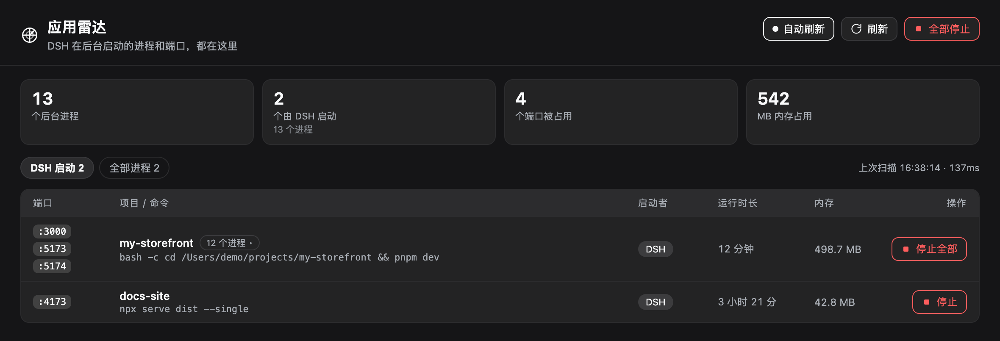
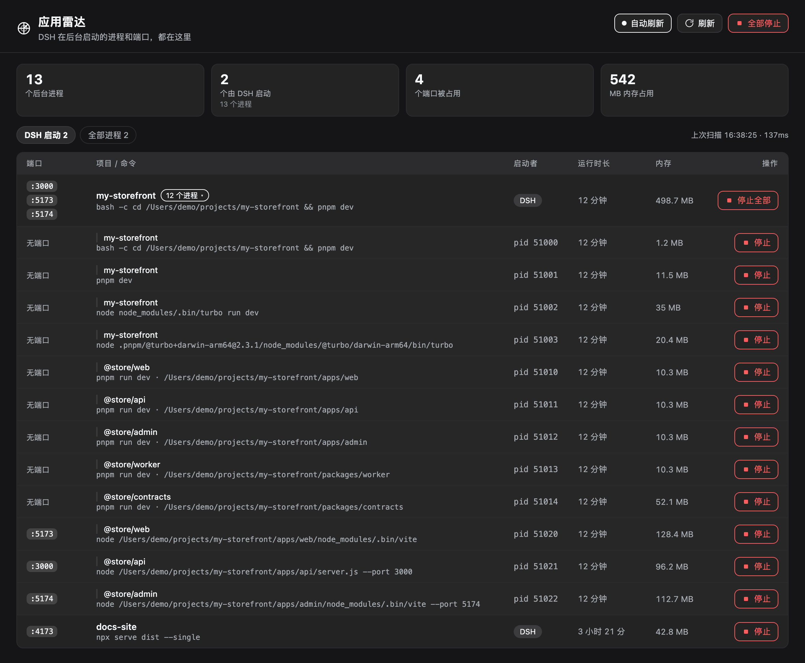
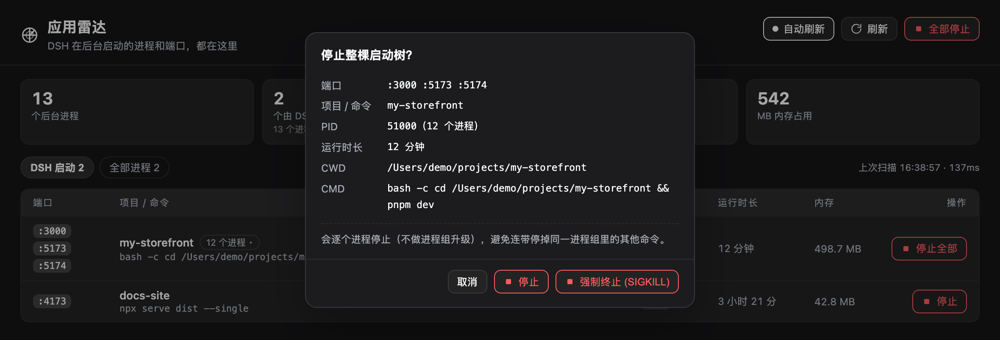

# 应用雷达 · App Radar

DSH 帮你改代码、跑项目时，经常会在后台留下 `npm run dev`、`vite`、`python -m http.server`
之类的长期进程。跑多了以后端口占了一堆，谁也说不清到底起了多少、哪个是 DSH 起的、还能不能停。
**应用雷达**就是给这件事做的一块控制台：侧栏点开，一次看清，一键收掉。

## 长这样

| 一眼看清有几棵树 | 展开看树里的进程 |
| --- | --- |
|  |  |



> 截图里的项目名、路径和 PID 都是演示数据（`/Users/demo/...`），不是任何人的真实进程。

## 它能做什么

- **一个页面看全**：侧栏多一个雷达图标，主区域是一整页控制台，列出后台进程的端口、项目名、
  启动者（DSH / 外部）、运行时长、内存、CPU、工作目录。
- **一条命令算一棵树**：`pnpm dev` 这类命令会拉出一长串进程（pnpm → turbo → 每个包一个 dev →
  每个 dev 一个端口），进程组还被 turbo 拆成好几个。面板按「宿主进程的直接子进程」把整条链
  归并成一行启动树：端口取并集、内存求和，点开能看到每个成员，停的时候一次收掉整棵树。
- **说清是谁起的**：靠两条线索判断「DSH 启动」——进程树的父链能不能走到 DSH 自己，
  以及进程环境变量里有没有 `DSH_SESSION_ID`（子进程会继承，所以哪怕被 `nohup` 甩到
  后台也能认出来）。
- **强制停止**：单棵启动树走「逐个进程 SIGTERM → 等 900ms → 仍在就 SIGKILL」，
  **不做进程组升级**（同一进程组里可能有别的命令）；单个进程停止时才会整组停。
- **一键全部停止**：把当前所有「DSH 启动」的进程一起收掉，不碰外部进程，也不碰 DSH 本体。
- **给模型一个工具**：`app_radar`，`action=list / kill / stop_all`。UI 和工具走同一份核心实现，
  行为一致。
- **自动刷新**：面板打开时每 4 秒刷新一次，页面切到后台就停；扫描结果有 1.2 秒缓存，
  多个调用方不会把机器打满。

## 安装

```sh
dsh plugin add dsh-app-radar
```

或者在 **设置 → 插件市场** 里搜「应用雷达」。装完刷新页面，侧栏就会出现雷达图标
（部分环境需要重启一次 DSH 才加载 Host 半边）。

要求 DSH `>=0.2.1-rc.1 <0.3.0-0`。目前只在 macOS 上验证过；Linux 未测试。

## 安全护栏

停止操作会拒绝这些目标（按钮变灰，鼠标悬停给出原因）：

- DSH 自身进程、DSH 的祖先进程、1 号进程；
- 不属于当前用户的进程；
- 应用本体（`DSH NEXT.app/Contents/...`）。

如果目标的进程组跟你所在的进程组是同一个，会自动降级成「只停这一个 pid」，不会连带把
DSH 带走。

## 数据从哪来

| 来源 | 用来做什么 |
| --- | --- |
| `ps -Aww -o pid,ppid,pgid,user,rss,pcpu,etime,stat,command` | 进程表：父链、运行时长、内存、CPU |
| `ps -ww -E -p <pids>` | 只看候选进程环境里有没有 `DSH_SESSION_ID` / `DSH_SHELL`，其余环境变量不外传、不落盘 |
| `lsof -nP -iTCP -sTCP:LISTEN -F pcgRuLn` | 监听端口，顺带 pid/pgid/ppid/uid |
| `lsof -a -d cwd -F pn -p <pids>` | 工作目录 → 项目名（找最近的 `package.json` / `.git`） |

`ps` 被系统策略挡住时会自动降级：只显示端口信息（没有时长和内存），停止功能仍然可用，
页面顶部会出现一条黄色提示说明降级了。

接口：`GET/POST /app-radar/api`，只接受本机回环来源。

## 目录

```
index.js            Host 半边：扫描、溯源、停止、HTTP 接口、app_radar 工具
client.js           浏览器半边：侧栏入口 + 主区域控制台（React，跟随 dsh 主题与语言）
cordis.patch.yml    把插件插进 profile 的 Loader 补丁
locale/{zh,en}.json 插件列表里的标题和说明
assets/icon-180.png 市场卡片图标（位图）；icon.svg 是 dsh 插件列表用的矢量图
assets/screenshots/ 市场详情页截图（演示数据：一棵 12 进程的 monorepo 启动树）
screenshots.json    告诉插件市场要展示哪几张截图
```

## 致谢 / Credits

这个插件的产品思路来自 **[laogou717/local-ops](https://github.com/laogou717/local-ops)**
（「总控台」——macOS 本地服务与批处理任务的指挥台，MIT 许可）。具体借鉴的是三点设计：

1. **后台服务 / 端口的集中管理界面**：把散落在各处的本地服务收进一个页面，而不是去翻端口；
2. **启动者溯源**：不只报「谁在监听」，还回答「这是谁启动的」；
3. **停止前的多重校验**：用进程组 + UID + 归属关系一起判断能不能安全地停，
   而不是「端口相同就杀」。

应用雷达没有复制 local-ops 的源代码：它用 DSH 插件（Cordis / Host + Client）重新实现，
溯源信号换成了 DSH 自己的进程树与 `DSH_SESSION_ID`，停止路径是自写的
`SIGTERM → SIGKILL` 进程组收敛。如果你需要的是不依赖 DSH 的独立 macOS 面板，
local-ops 本身更合适——那个项目比这里完整得多。

详见 [CREDITS.md](CREDITS.md)。

## License

MIT
